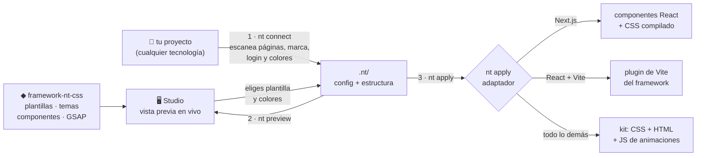

<div align="center">

# ◆ framework-nt-css

**Un único sitio para el diseño de todos tus proyectos.**
Plantillas, colores, componentes y animaciones viven aquí; tus proyectos solo ponen sus páginas.

React 19 · Tailwind CSS 4 · GSAP 3 · lucide · Agent Skill multiplataforma

</div>

---

## Índice

- [La idea en 30 segundos](#la-idea-en-30-segundos)
- [Cómo funciona](#cómo-funciona)
- [Instalación](#instalación-una-sola-vez)
- [Usarlo en un proyecto que ya existe](#usarlo-en-un-proyecto-que-ya-existe)
- [Crear un proyecto nuevo](#crear-un-proyecto-nuevo)
- [Colores: el Theme Studio](#colores-el-theme-studio)
- [Plantillas y migración](#plantillas-y-migración)
- [Pedírselo a un agente](#pedírselo-a-un-agente)
- [Referencia de comandos](#referencia-de-comandos)
- [Qué hay dentro](#qué-hay-dentro)
- [Problemas frecuentes](#problemas-frecuentes)

---

## La idea en 30 segundos

Normalmente cada proyecto copia su layout, sus colores y sus componentes, y con el tiempo cada uno acaba distinto.
Aquí es al revés: **el estilo vive en el framework** y los proyectos se conectan a él.

| | |
|---|---|
| 🧩 **Plantillas** | Estructuras de página intercambiables: `sidebar` (la de Hoopbase) y `navbar-center`. Cambiar de una a otra no toca el código. |
| 🎨 **Temas** | 15 colores con nombre (`canvas`, `paper`, `ink`, `accent`…). Se eligen en vivo en el **Theme Studio** y se guardan con un clic. |
| ✨ **Animación** | GSAP en todo: pantalla de precarga, entrada de la plantilla, páginas escalonadas, skeletons mientras cargan los datos. |
| 🌍 **Cualquier tecnología** | El framework usa su propia tecnología y **trabaja por encima del proyecto**: escanea su estructura, enseña una vista previa y luego lo aplica según su stack (Next, React + Vite, ASP.NET, Laravel, Django, Vue, HTML…). |
| 🤖 **Agent Skill** | Incluye `SKILL.md` + `AGENTS.md` (estándar abierto), así que Claude Code, Codex, Gemini CLI, Cursor o Copilot saben usarlo. |

Si cambias algo aquí (un color, un componente, una plantilla), **todos los proyectos conectados lo heredan**.

---

## Cómo funciona



**Los tres pasos:**

1. **`nt connect`** lee el proyecto *sin modificarlo* y guarda lo que necesita en `.nt/project.json`: tecnología, nombre, páginas con sus rutas, si tiene login y qué colores usa ahora.
2. **`nt preview`** abre el Studio con **tu** proyecto (tu marca, tus páginas, tu menú) pintado con la plantilla y los colores del framework. Lo pruebas todo en vivo antes de tocar nada.
3. **`nt apply`** genera dentro de `.nt/` la pieza que encaja con tu tecnología y un **`.nt/INTEGRATION.md`** con los pasos exactos para conectarla, cada uno marcado como ✅ hecho o ⬜ pendiente.

> [!NOTE]
> `nt apply` **solo escribe dentro de `.nt/`**. Los cambios en el código del proyecto (dependencia, configuración, layout) están en `INTEGRATION.md` y los haces tú o tu agente, una sola vez y con tu visto bueno.

### Un adaptador por tecnología

| Tecnología del proyecto | Adaptador | Qué recibe el proyecto |
|---|---|---|
| **Next.js** | `next` | `NtShell` y `NtBoot` (conectados al router de Next) + `nt.css` compilado. Usa los componentes React del framework. |
| **React + Vite** | `react-vite` | El plugin `framework-nt-css/vite` + un `NtShell` generado. Tailwind del framework escanea también el proyecto. |
| **Cualquier otra** (ASP.NET, Laravel, Django, Rails, PHP, Vue/Nuxt, Svelte/SvelteKit, Astro, Angular, HTML…) | `kit` | `nt.css`, la plantilla en HTML (`layout.html`), `nt.js` (precarga, animaciones, página activa, menú móvil), GSAP y `preview.html`. |

El kit no es una imitación: el HTML se genera **renderizando los mismos componentes React** del framework, y el CSS se compila con su Tailwind. Se ve exactamente igual.

---

## Instalación (una sola vez)

```powershell
cd C:\dev
git clone https://github.com/fsanchezux/framework-nt-css.git
cd framework-nt-css
npm install
```

Para que tu agente de IA lo encuentre desde cualquier proyecto:

```powershell
node scripts/nt.mjs install-skill
```

Crea enlaces en `~/.claude/skills/framework-nt-css` y `~/.agents/skills/framework-nt-css`. Al ser enlaces, cualquier cambio en el framework llega al instante.

> [!TIP]
> En los ejemplos, `nt` significa `node C:\dev\framework-nt-css\scripts\nt.mjs` (cambia `C:\dev` por la carpeta donde lo hayas clonado). Dentro de un proyecto que ya tiene el framework como dependencia puedes usar directamente `npx nt …`.

---

## Usarlo en un proyecto que ya existe

Ejemplo con `wishlist-nt` (Next.js), que está al lado del framework en `C:\dev`.

### 1 · Conectar

```powershell
node scripts/nt.mjs connect ..\wishlist-nt
```

```text
✔ Conectado: C:\dev\wishlist-nt
  tecnología: Next.js 16.4.6 → adaptador "next" · TypeScript · Tailwind 4
  marca: WHISLIT · usuario: sí (supabase)
  páginas (4):
   /          landing  Inicio · app/page.tsx
   /invite    form     Invite · app/invite/page.tsx
   /lists     list     Lists  · app/lists/page.tsx
   /login     auth     Login  · app/login/page.tsx
  colores actuales: #b20000 #1a1a1a #000000 #ededed …
```

¿Algo detectado mal? Corrígelo en `.nt/project.json` → `"overrides"` (se conserva aunque vuelvas a escanear):

```jsonc
"overrides": {
  "brand": { "name": "Whislit" },
  "pages": {
    "lists":  { "label": "Mis listas", "icon": "List" },
    "invite": { "hidden": true },          // fuera del menú
    "login":  { "shell": false }           // sin plantilla (por defecto en las de login)
  }
}
```

### 2 · Elegir plantilla y colores viéndolo

```powershell
node scripts/nt.mjs preview ..\wishlist-nt
```

Se abre `http://localhost:5180` con tu proyecto. En el panel de la derecha:

- cambias la **plantilla** y lo ves al momento;
- tocas **cada color** (selector o hexadecimal), con avisos de contraste;
- en **Colores del proyecto** tienes la paleta que ya usaba la app: un clic y se asigna al token seleccionado;
- **Guardar tema** lo guarda en `themes/` del framework y **Usar en wishlist-nt** lo deja como tema y plantilla del proyecto.

### 3 · Aplicar

```powershell
node scripts/nt.mjs apply ..\wishlist-nt
```

```text
✔ Aplicado: Next.js 16.4.6 → adaptador next · plantilla sidebar · tema esmaix
  .nt/nt.css
  .nt/next/NtShell.tsx
  .nt/next/NtBoot.tsx
  .nt/INTEGRATION.md

! Pasos pendientes en el código del proyecto (4/4), detallados en .nt/INTEGRATION.md:
  [ ] Dependencia del framework y regeneración automática  (package.json)
  [ ] Next.js: compilar el framework                       (next.config.ts)
  [ ] Layout raíz: CSS, pantalla de arranque y plantilla   (app/layout.tsx)
  [ ] Páginas: quitar el chrome propio que ahora pone la plantilla
```

Abre `.nt/INTEGRATION.md` y sigue los pasos, o pídeselo a tu agente: *«aplica los pasos de .nt/INTEGRATION.md»*. Para Next, por ejemplo, el layout queda así:

```tsx
import '@/styles/globals.css'
import '../.nt/nt.css'                 // estilo del framework, después del CSS del proyecto
import NtBoot from '../.nt/next/NtBoot'
import NtShell from '../.nt/next/NtShell'

export default function RootLayout({ children }: { children: React.ReactNode }) {
  return <html lang="es">
    <body>
      <NtBoot/>                          {/* pantalla de precarga */}
      <NtShell>{children}</NtShell>      {/* plantilla: marca, menú, usuario, fondo */}
    </body>
  </html>
}
```

Vuelve a ejecutar `nt apply` cuando quieras: los pasos ya hechos se detectan solos y salen marcados `[x]`. Con `"predev": "nt apply --quiet"` en `package.json` se regenera al arrancar, así el proyecto sigue siempre al framework.

### En otras tecnologías

Es igual. Solo cambia lo que genera `apply` y los pasos de `INTEGRATION.md`. Con el kit, por ejemplo en ASP.NET:

1. copias `.nt/kit/{nt.css,nt.js,gsap.min.js}` a `wwwroot/nt/`;
2. pasas la estructura de `.nt/kit/layout.html` a `Pages/Shared/_Layout.cshtml`, poniendo `@RenderBody()` donde está `<!-- nt:content -->`;
3. abres `.nt/kit/preview.html` en el navegador para ver el resultado esperado.

| Stack | Layout | Hueco del contenido |
|---|---|---|
| ASP.NET | `_Layout.cshtml` | `@RenderBody()` |
| Laravel | `layouts/app.blade.php` | `@yield('content')` / `{{ $slot }}` |
| Django | `templates/base.html` | `` |
| Rails | `layouts/application.html.erb` | `<%= yield %>` |
| Nuxt / Vue | `layouts/default.vue` / `App.vue` | `<slot />` / `<RouterView />` |
| SvelteKit | `+layout.svelte` | `{@render children()}` |
| Astro | `layouts/Layout.astro` | `<slot />` |
| Angular | `app.component.html` | `<router-outlet />` |

En apps de una sola página, define `window.NT_KIT = { navigate: (ruta) => router.push(ruta) }` antes de `nt.js` y llama a `ntKit.refresh()` al cambiar de ruta.

---

## Crear un proyecto nuevo

```powershell
node scripts/nt.mjs init ..\mi-app --template sidebar --theme esmaix --name "Mi app" --install
cd ..\mi-app
npm run dev
```

Sin opciones, `init` te pregunta la plantilla y el tema. El proyecto nace con React + Vite y la estructura de Hoopbase. Su `App.jsx` solo describe **datos** (marca, menú, usuario) y páginas:

```jsx
import { NtApp, Page, PageTitle } from 'framework-nt-css'

export default function App() {
  return <NtApp brand={{ name: 'Mi app' }} nav={NAV} activeId={view} onNavigate={setView}>
    <Page><PageTitle title="Inicio"/></Page>
  </NtApp>
}
```

---

## Colores: el Theme Studio

```powershell
node scripts/nt.mjs theme                       # solo el framework, con la app de muestra
node scripts/nt.mjs preview ..\mi-proyecto      # con la estructura de un proyecto
```

Los colores son **tokens con nombre**, nunca hexadecimales sueltos en el código:

| Grupo | Tokens |
|---|---|
| Superficies | `canvas` (fondo) · `sidebar` · `paper` (tarjetas) |
| Texto | `ink` · `muted` |
| Marca | `accent` · `accent-strong` · `accent-soft` · `on-accent` |
| Estados | `success` · `warning` · `danger` |
| Degradado | `glow-base` · `glow-deep` · `glow` |

En Tailwind se usan como `bg-paper`, `text-ink/45`, `bg-accent`, `border-ink/[.07]`. En CSS normal, como `var(--nt-accent)`.
Temas incluidos: **esmaix** (oscuro, naranja), **midnight** (oscuro, azul) y **paper** (claro).

---

## Plantillas y migración

Todas las plantillas cumplen el mismo **contrato de slots**: `brand`, `modes`, `nav`, `panel`, `footer`, `user`, `actions` y el contenido. Por eso cambiar de plantilla es cambiar una línea de configuración:

```powershell
node scripts/nt.mjs migrate ..\mi-app --template navbar-center
node scripts/nt.mjs apply ..\mi-app        # en proyectos conectados que no son Vite
```

Para crear una plantilla nueva a partir de otra:

```powershell
node scripts/nt.mjs new-template mi-plantilla --from sidebar --name "Mi plantilla"
```

Edita `templates/mi-plantilla/Shell.jsx`, mírala en el Studio y comprueba con `nt doctor`. Al instante está disponible para todos los proyectos.

---

## Pedírselo a un agente

Con el skill instalado, basta con hablarle normal desde cualquier proyecto:

- *«Conecta este proyecto a framework-nt-css y enséñame la vista previa»*
- *«Quiero elegir los colores de la app»*
- *«Aplica el framework y sigue los pasos de .nt/INTEGRATION.md»*
- *«Pásalo a la plantilla con la navbar centrada»*
- *«Crea un proyecto nuevo con la estructura de Hoopbase»*

El agente sigue `SKILL.md`: pregunta qué plantilla y qué tema quieres, usa el CLI y te enseña la vista previa antes de tocar código.

---

## Referencia de comandos

| Comando | Para qué |
|---|---|
| `nt connect <dir>` | Escanea un proyecto existente y crea `.nt/`. `--print` solo muestra lo detectado. |
| `nt preview <dir>` | Studio con la estructura del proyecto: plantilla y colores en vivo. |
| `nt apply <dir>` | Genera la integración en `.nt/` y `INTEGRATION.md`. `--dry-run`, `--adapter next\|react-vite\|kit`, `--quiet`. |
| `nt init <dir>` | Proyecto nuevo (React + Vite) desde el starter. |
| `nt theme` | Theme Studio con la app de muestra. |
| `nt migrate <dir> --template <id>` | Cambia plantilla y/o tema (`--theme <id>`) sin tocar código. |
| `nt templates` · `nt themes` | Lista lo disponible (`--json` para agentes). |
| `nt new-template <id>` · `nt new-theme <id>` | Crea una plantilla o un tema copiando otro (`--from`). |
| `nt doctor [dir]` | Valida el framework o un proyecto (`--fix` regenera el registro de plantillas). |
| `nt sync <dir>` | Alinea las versiones de dependencias del proyecto con las del framework. |
| `nt install-skill` | Enlaza el skill en `~/.claude/skills` y `~/.agents/skills`. |

`node scripts/nt.mjs help` muestra todas las opciones.

---

## Qué hay dentro

```text
framework-nt-css/
├─ SKILL.md · AGENTS.md         instrucciones para agentes (usar / modificar el framework)
├─ templates/<id>/              plantillas: template.json (manifiesto) + Shell.jsx (layout + animación)
├─ themes/<id>.json             temas de color
├─ src/
│  ├─ components/               Button, Card, Page, Field, Overlay, Nav, Data…
│  ├─ motion/                   GSAP: Preloader, Reveal, Loadable, Counter, Typewriter
│  ├─ theme/tokens.js           fuente única de los tokens de color
│  ├─ styles/                   index.css (Vite) · standalone.css (CSS compilado) · framework.css
│  ├─ kit/                      runtime vanilla (nt.js) y render de plantillas a HTML
│  ├─ node/                     escáner, apply, kit y compilador de CSS (los usa el CLI)
│  └─ vite/plugin.js            plugin de Vite para proyectos React + Vite
├─ studio/                      Theme Studio y vista previa de proyectos
├─ starter/                     base de los proyectos nuevos
├─ scripts/nt.mjs               el CLI
└─ references/                  documentación detallada y schemas JSON
```

Y en cada proyecto conectado:

```text
mi-proyecto/.nt/
├─ nt.config.json      plantilla + tema elegidos              (lo editas tú o el Studio)
├─ project.json        lo que detectó el escáner + overrides  (tus correcciones van en "overrides")
├─ INTEGRATION.md      pasos para tu tecnología, con su estado
├─ nt.css · next/ · react/ · kit/   código generado por nt apply (no se edita a mano)
```

Para profundizar: [`architecture.md`](references/architecture.md), [`app-contract.md`](references/app-contract.md), [`templates.md`](references/templates.md), [`themes.md`](references/themes.md), [`components.md`](references/components.md), [`motion.md`](references/motion.md), [`migration.md`](references/migration.md).
¿Vas a modificar el propio framework? Lee [`AGENTS.md`](AGENTS.md).

---

## Problemas frecuentes

<details>
<summary><b>La pantalla de precarga se queda parada</b></summary>

Pasa en pestañas en segundo plano o paneles ocultos: el navegador pausa las animaciones. Pon la pestaña delante. Además, la app se marca como lista sola a los 4 s pase lo que pase.
</details>

<details>
<summary><b>Next.js: «Module not found» con framework-nt-css</b></summary>

El framework está fuera de la carpeta del proyecto. Revisa en `next.config` el paso 2 de `INTEGRATION.md`: `transpilePackages: ["framework-nt-css"]` y `turbopack.root` / `outputFileTracingRoot` apuntando a la carpeta común a los dos.
</details>

<details>
<summary><b>He cambiado el framework y el proyecto no lo refleja</b></summary>

Los proyectos React + Vite lo ven al instante. Los de Next y los del kit usan CSS compilado, así que hay que ejecutar `nt apply` (o tener `"predev": "nt apply --quiet"`). En el kit, vuelve a copiar los recursos a la carpeta pública.
</details>

<details>
<summary><b>El escáner no encuentra una página o le pone un nombre raro</b></summary>

Corrígelo en `.nt/project.json` → `"overrides"` (nombre, icono, tipo, oculta, sin plantilla) y ejecuta `nt apply`. Los overrides sobreviven a los reescaneos.
</details>

<details>
<summary><b>Despliegue (Vercel, servidor…)</b></summary>

La dependencia `file:` solo existe en tu máquina. Para desplegar, publica el framework (registro npm privado o Git) y cambia la dependencia a esa versión. Pendiente de automatizar.
</details>
